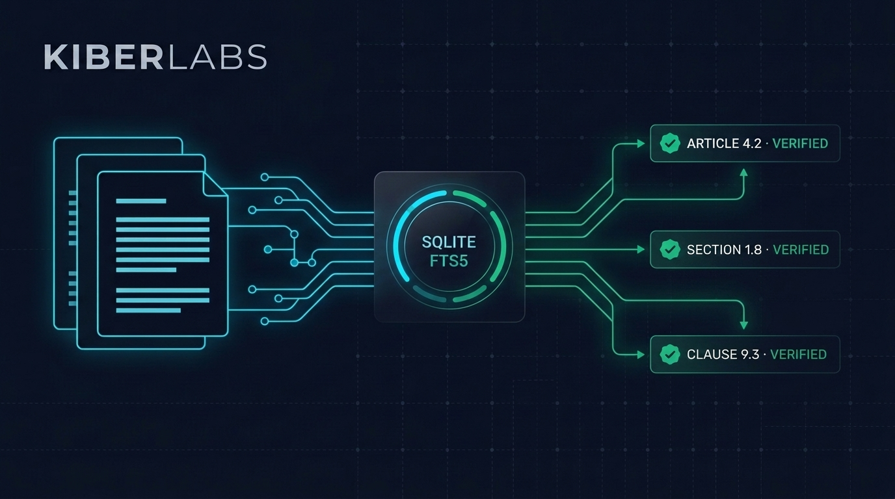
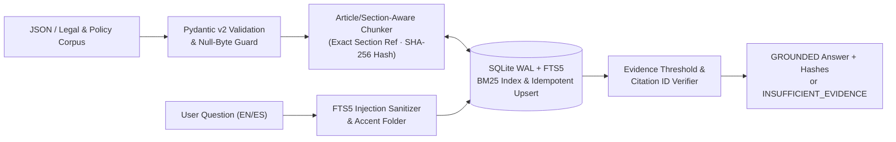

# KiberLabs — B2B RAG & Grounded Citation Engine

[](https://github.com/Kiberlabs/b2b-rag-citation-engine/actions/workflows/ci.yml)



A deterministic **Python 3.11+ RAG ingestion, SQLite FTS5/BM25 retrieval, and zero-hallucination citation verification engine** designed for legal codes, regulatory compliance teams, and B2B knowledge bases.

Instead of blindly stuffing raw text into an LLM prompt and hoping citations are real, `rag-citation-engine` segments documents strictly by **Article / Section / Clause**, indexes them in concurrent **SQLite (`WAL` + `FTS5`)** with bilingual accent-folding (`EN`/`ES`), sanitizes user queries against FTS5 syntax injection, and deterministically **abstains (`INSUFFICIENT_EVIDENCE`)** whenever no verified corpus clause meets the evidence threshold.

---

## Architecture



## Key Engineering Highlights

- **Article- & Section-Aware Chunking:** Preserves exact legal references (`Article 4`, `Section 2`, `Artículo 3`) with deterministic 16-char SHA-256 chunk hashes so every retrieved snippet is auditable back to its source clause.
- **Zero-Hallucination Guardrails:** Enforces lexical overlap thresholds (`min_token_overlap`) and verifies every returned `chunk_id` against the persisted SQLite `chunks` table before emitting a `GROUNDED` verdict; off-topic queries safely return `INSUFFICIENT_EVIDENCE`.
- **Concurrent SQLite WAL + FTS5 BM25:** Uses `PRAGMA journal_mode=WAL`, `busy_timeout=5000`, `unicode61 remove_diacritics 2` (accent-insensitive bilingual search), and idempotent document re-ingestion (replacing stale chunks atomically).
- **FTS5 & SQL Injection Hardening:** Strips boolean operators (`OR`, `NOT`, `NEAR`), quotes, and wildcard punctuation before executing FTS5 `MATCH` queries.

---

## Quickstart

```bash
# 1. Run the automated pytest verification suite
python -m pytest -v

# 2. Ingest the sample B2B compliance corpus and execute a grounded citation query
PYTHONPATH=src python -m rag_engine query \
  --corpus data/sample_corpus.json \
  --db data/rag.db \
  --q "What is the deadline for data breach notification?"
```

### Sample Output

```text
[KiberLabs RAG] Docs=3 | Chunks=7 | Status=GROUNDED | Verified=True
  Summary: Grounded in [REG-GDPR-2026 · Article 4: Incident Notification Deadline]: Article 4: Incident Notification Deadline Upon discovering a confirmed personal data breach, the data processor must notify the controller without undue delay and no later than 72 hours after detection, including affected record counts and mitigation steps.
  -> [REG-GDPR-2026 | Article 4: Incident Notification Deadline] overlap=80% hash=3d35debad5472617
```

---

## Project Layout

```text
b2b-rag-citation-engine/
├── assets/
│   └── cover_04_rag_engine.jpg   # 16:9 architecture cover
├── data/
│   └── sample_corpus.json        # Synthetic B2B EN/ES compliance & SLA corpus
├── src/rag_engine/
│   ├── models.py                 # Pydantic v2 document, chunk, citation & verdict schemas
│   ├── chunker.py                # Article/section-aware parser & SHA-256 fingerprinting
│   ├── storage.py                # Concurrent SQLite WAL + FTS5 BM25 index & verifier
│   ├── retriever.py              # FTS5 query sanitizer, overlap filter & abstention gate
│   └── cli.py                    # CLI runner (human summary + structured JSON output)
└── tests/
    └── test_rag_engine.py        # Unit, bilingual FTS5, injection, WAL & CLI tests
```

---

## License

MIT — Built by **KiberLabs Engineering** (*AI & Python Automation Studio*).
